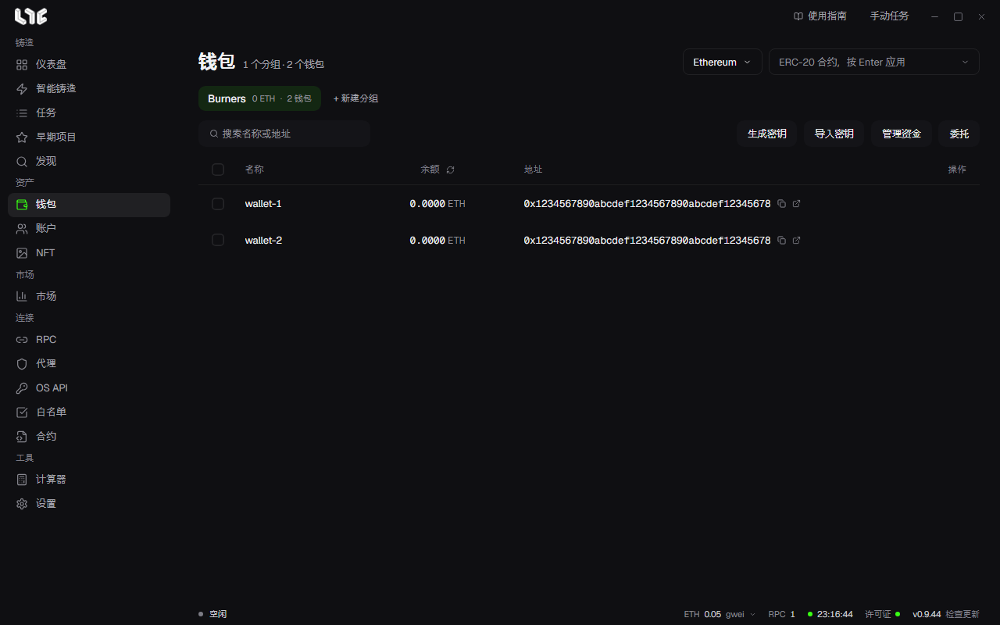

# 钱包

链上任务用到的钱包都放在这里。钱包按分组管理。

## 分组

用 **+ 新建分组** 创建分组，按目的、链或用途来划分。可以重命名分组，也可以调整顺序。

删除分组时，其中的钱包也会一并删除。删除前会先弹出确认窗口。

## 添加钱包

- **生成密钥**：设定数量，创建新钱包。密钥在这台电脑上生成。
- **导入密钥**：每行填一个。可以填 `名称,私钥`，也可以只填私钥。

可以在行里重命名钱包或删除钱包。

## 查看余额

在右上角选择链，就会读取原生代币余额。在 **ERC-20 合约** 栏里填入地址并按 Enter，就能查看该代币的余额。读取失败的格子显示为 `-`，而不是 `0`。这样可以区分是 RPC 没有响应，还是钱包本身是空的。

## 从单个钱包发送

点击行里的发送按钮，会打开 **发送资金** 窗口。填入接收地址和数量。**发送最大值** 会发送扣除 Gas 之后的全部金额。

## 资金管理：分发与归集

选择钱包，点击 **管理资金**。

- **分发**（一对多）：从一个来源钱包向多个钱包发送。如果链上有分发合约，一笔交易就能完成；没有的话，就逐个钱包发送。
- **归集**（多对一）：把多个钱包的资金归集到一个钱包或外部地址。

数量有两种设定方式。

- **每钱包数量**：固定金额或随机范围。选随机时，每个接收钱包的金额都不同。
- **每钱包目标余额**：把接收钱包补足到该余额，或者让发送钱包只留下这么多，其余取出。

填入 **ERC-20 合约地址** 就会转移该代币。留空则转移原生代币。Gas 用原生代币支付。

## 解包 WETH 与委托

- **解包 WETH**：把所选钱包里的 WETH 换回 ETH。没有 ETH 支付 Gas 的钱包会被跳过。
- **委托**：检查并撤销钱包的 EIP-7702 委托状态。一些铸造合约会拒绝已委托的钱包。见[合约](../tools/contracts.md)。

## 密钥是怎么保存的

钱包保存在 `%LOCALAPPDATA%\nogada\data\wallets.dat`。该文件用 Windows DPAPI 加密，并绑定到这台电脑和当前用户。

> **注意**：删除的钱包，应用无法恢复。删除重要钱包之前，请先[备份](../reference/backup-restore.md)，或导出密钥并妥善保管。只有在删除之前做的备份，并且你记得密码时，备份才有用。
