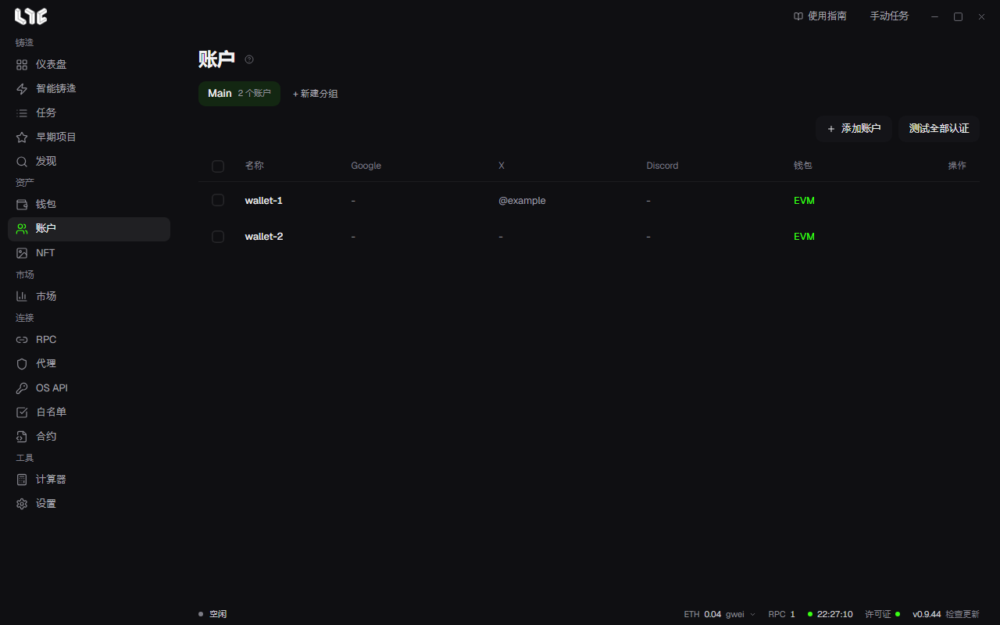

# 账户与社交任务

Google 表单、X 关注、加入 Discord 这类白名单申请工作，也可以像用多个钱包铸造那样，用多个账户一起完成。任务在 **任务 → 社交** 标签中，任务使用的身份在 **账户** 菜单中。

## 社交任务能做什么

在 **任务 → 社交** 标签中创建分组，点击 **新建社交任务**。任务类型如下：

| 类型 | 可以做的事 |
|---|---|
| Google 表单 | 填入表单地址后点击 **解析** 加载问题。每个问题可以让所有账户提交相同答案、每个账户随机选择，或在你的答案中加入 `{wallet}` 等值。Google 邮箱栏用账户的 Gmail 填写。需要登录的表单只由已连接 Google 的账户提交。 |
| X 操作 | 关注、取消关注、点赞、转推、回复推文、引用推文、发推 |
| Discord | 加入服务器（含加入后发送消息）、点击消息按钮和添加反应、退出服务器 |
| Alphabot | 账户关联、查看 Alphabot 和 Rumble 抽奖 |

每种类型还要填写任务名称、账户分组、代理分组（可选）和账户之间的延迟（秒，范围）。在文本栏中写 `{wallet}`、`{gmail}`、`{xhandle}` 等，会替换成每个账户自己的值。

有任务失败时，用社交标签底部栏的 **重试失败项** 只重新运行这些任务。

有验证码的任务需要在 **设置 → 集成 → 验证码求解器 API 密钥** 中填入 CapMonster、CapSolver、2captcha 或 AnySolver 之一的密钥。Discord 任务的验证码使用 AnySolver 密钥。

## 账户

账户是一个钱包加上与它配套的 Gmail、X、Discord 和代理。其中的全部内容，包括令牌和 Cookie，都加密保存在这台电脑上。删除账户会删除整组信息，没有同时导入到钱包菜单的钱包将无法找回私钥。

### 添加一个账户

还没有账户分组时先用 **+ 新建分组** 创建，然后点击 **添加账户**。

| 栏位 | 填写内容 |
|---|---|
| 显示名称、私钥 | 必填。私钥就是账户的钱包。 |
| 代理 | 该账户使用的代理。 |
| Gmail、应用专用密码 | Gmail 地址和 Google 应用专用密码（16 位）。点击 **连接 Google** 会打开这个账户专用的 Chrome 配置文件，在里面登录 Google 后，需要登录的表单会使用它。需要先保存账户才能点击。 |
| X 用户名、X Cookie | X 用户名（不带 @）和 auth_token Cookie 值。有 Cookie 时优先使用 Cookie。 |
| Discord 用户名、Discord 令牌 | 有令牌时优先使用令牌。 |

### 一次添加多个

- **从钱包分组**：用 **+ 新建分组** 创建账户分组时，在 **从钱包导入** 中选择钱包分组，里面的钱包都会成为账户。Gmail、X、Discord 和代理栏一开始是空的，之后在编辑中补充。
- **从文本**：批量导入每行一个账户，按 `name,key,gmail,apppass,xhandles,discordusername` 的顺序，用逗号或 Tab 分隔。后面的栏位可以留空。

### 检查认证

**测试全部认证** 会一行一行地检查，以免触发各服务商的频率限制，确认每个 Gmail 应用专用密码、X Cookie 和 Discord 令牌是否仍然有效。行上的按钮只检查这一行。

## 模块

**任务 → 模块** 标签列出从许可证服务器获取的任务模块。分为 **链上** 和 **社交**，可以搜索，也可以隐藏不用的模块。新推送的模块用刷新按钮获取，无需重启应用。

## 答案模板

想让每个账户填不同的答案，就在 **设置 → 密钥模板** 中制作答案组：起一个名字，每行写一个答案。在社交任务的文本栏中用花括号写上名字，例如 `{colors}`，每个账户就会拿到组里的一行。

例：三行的答案组 `colors`（红、蓝、绿）给五个账户使用时

- **顺序**：账户 1 到 5 依次得到红、蓝、绿、红、蓝。行用完后从第一行重新开始。
- **随机**：先打乱各行，再按同样方式分配。打乱的顺序由账户分组和答案组名称决定，所以同一个分组每次创建任务都会得到相同的答案。
