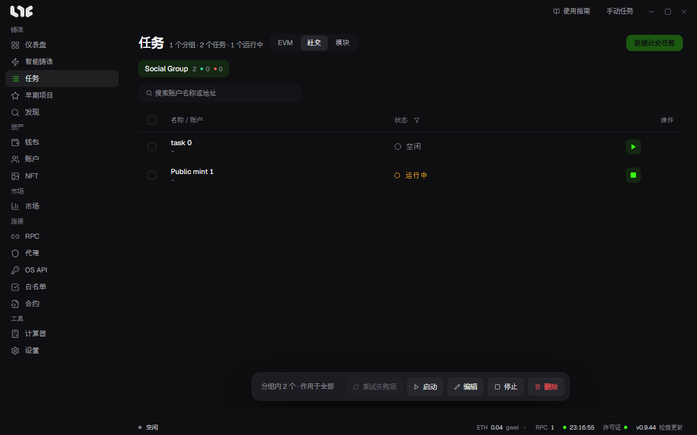

# 社交任务

社交任务用多个账户处理不涉及链的事。Google 表单、X 和 Discord 操作、注册流程、白名单申请、固定任务的提交，都属于这一类。

## 需要什么

- **账户**：保存钱包地址、Gmail、X 用户名和 Cookie、Discord 信息、代理。见[社交账户](../setup/accounts.md)。
- **验证码求解器**：只有带 hCaptcha、Turnstile、reCAPTCHA v2/v3 的模块才需要。在 **设置 → 集成** 里填入密钥。
- **浏览器会话**：只有需要登录的 Google 表单或浏览器引擎模块才需要。

## Google 表单

**任务 → 社交 → 新建社交任务** 可以创建 Google 表单、X 操作、Discord 和 Alphabot 任务。

1. 打开或创建一个社交分组。
2. 点击 **新建社交任务**，选择 **Google 表单**。
3. 填入 Google Forms 的 URL，点击 **解析**。先以匿名方式读取，被拦住时，用账户分组里已连接的 Google 账户读取。
4. 选择账户分组。每个账户生成一个任务。
5. 逐个问题设定答案。可以使用账户值、固定值、随机选择、自动填充。
6. 保存。

不支持的题型（线性量表、网格、日期、时间、文件上传）会在提交时跳过。如果不是必答题，表单仍可能接受其余内容。

## X 操作

选择关注、取消关注、点赞、转推、回复、引用、发推等操作。每个账户使用各自保存的 X Cookie。请先用 **测试全部认证** 确认 Cookie 仍然有效。

## Discord 操作

每个账户各自执行加入服务器、退出服务器、点击消息按钮和添加表情回应。验证码使用设置里的 AnySolver 密钥。退出服务器的间隔为 2.5 秒。

## Alphabot

用账户的钱包登录后，连接已保存的 Discord 和 X 会话。

## 社交模块

这是运营者上传的网站专用流程。从 **任务 → 模块** 开始。窗口会锁定在该模块上打开，只需填写模块规定的栏位。

1. 打开 **任务 → 模块**。
2. 选择社交模块。
3. 选择账户分组。
4. 填写模块的栏位。
5. 如果有验证码，选择求解服务。不选则无法继续。
6. 保存。

模块通过两种引擎运行：使用普通请求的 `http` 引擎，和用于必须使用真实浏览器的网站的 `browser` 引擎。用哪一种由模块作者决定。

## 账户之间不会混用

一个任务只使用一个账户，即该账户的钱包、用户名、Gmail、代理和浏览器配置文件。缺少必需值的任务，不会换成别的账户，而是在行日志里写明原因，然后跳过或失败。

## 验证码处理

验证码栏由模块决定。运行时用设置里的服务和密钥求解，并把得到的令牌放进请求。没有求解服务时，窗口会拦住你，或者该行会因配置错误而失败。

详情见[答案模板与社交模块](templates-modules.md)。
