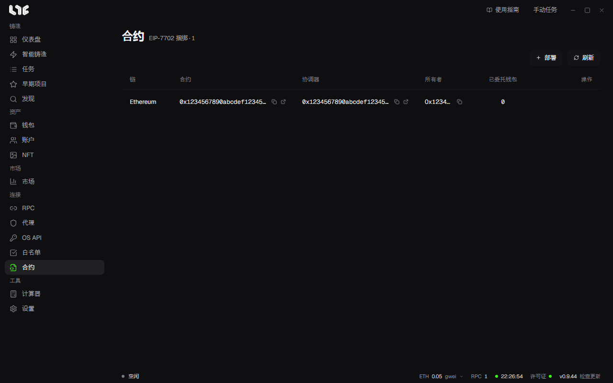

# 捆绑与合约

捆绑是把多个钱包的铸造合成一笔交易发送的方式。不是每个钱包各发一笔交易，而是先把钱包通过 EIP-7702 委托给执行器合约，再用一笔经过协调器合约的交易一次性完成铸造。

使用捆绑需要按顺序做三件事。

1. 在链上部署捆绑器合约。
2. 把钱包委托给它的执行器。
3. 创建捆绑任务。

## 1. 部署捆绑器合约

在 **合约** 中点击 **部署**。

| 栏位 | 填写内容 |
|---|---|
| 链 | 要使用捆绑的链。 |
| 所有者钱包 | 负责部署并拥有合约的钱包。部署 Gas 由它支付。 |
| RPC 分组 | 发送部署交易的 RPC。该链没有 RPC 时会提示先到 RPC 页面添加。 |
| 最高费用、优先费 | 留空为自动。 |

部署完成后，协调器和执行器会在表格中显示为一行。表格显示链、合约、协调器、所有者和已委托钱包数。

该行的操作：

- 在区块浏览器中打开、复制所有者地址
- **委托钱包**、**撤销钱包委托**
- **删除合约**：只删除应用内的记录。链上的合约和委托不变。

## 2. 委托钱包

点击该行的 **委托钱包** 会打开 **配置委托** 窗口。

- 选择要委托的钱包。
- **Gas 支付方**：支付委托交易 Gas 的一个钱包。
- **委托给**：固定为该行的执行器合约地址。

委托后的钱包从此带有执行器合约的代码。只把这种权限交给你自己部署的执行器，收回时用 **撤销钱包委托**。

哪个钱包委托给了哪里，可以在 **钱包** 页面用 **委托** 按钮查看。

## 3. 创建捆绑任务

在 **任务** 页面点击 **新建捆绑**，或选择同一条链上的多个任务后点击底部栏的 **捆绑**。

第一步 **创建捆绑** 中，像普通任务一样填写链、合约、函数、金额和参数，并选择 **捆绑器合约** 和钱包。**钱包兼容性** 显示所选钱包是否已委托给该执行器。点击 **继续** 进入捆绑设置。

| 栏位 | 含义 |
|---|---|
| 铸造支付 | 由谁支付铸造价格：**合约所有者支付** 或 **每个钱包支付**。 |
| 调用 Gas 上限 | 单个钱包铸造调用的 Gas 上限。 |
| 外层 Gas 上限 | 整笔捆绑交易的 Gas 上限。 |
| 每次成功的构建者小费 | 每成功铸造一次付给区块构建者的小费。 |
| 最高费用、优先费 | 留空为自动。 |
| 时间戳 | 发送时间。所选任务的时间戳不同时，会要求填写捆绑使用的时间。 |
| 连发、延迟 | 开启后按设定间隔反复发送捆绑交易。 |
| RPC 节点 | 发送捆绑交易的 RPC。 |

放进捆绑的任务必须都在同一条链上。该链上没有完成部署和委托的合约时，会提示先完成。

发射时如果有钱包还没准备好铸造，会先发送第一笔交易，这些钱包准备好后再放进第二笔交易发送。
