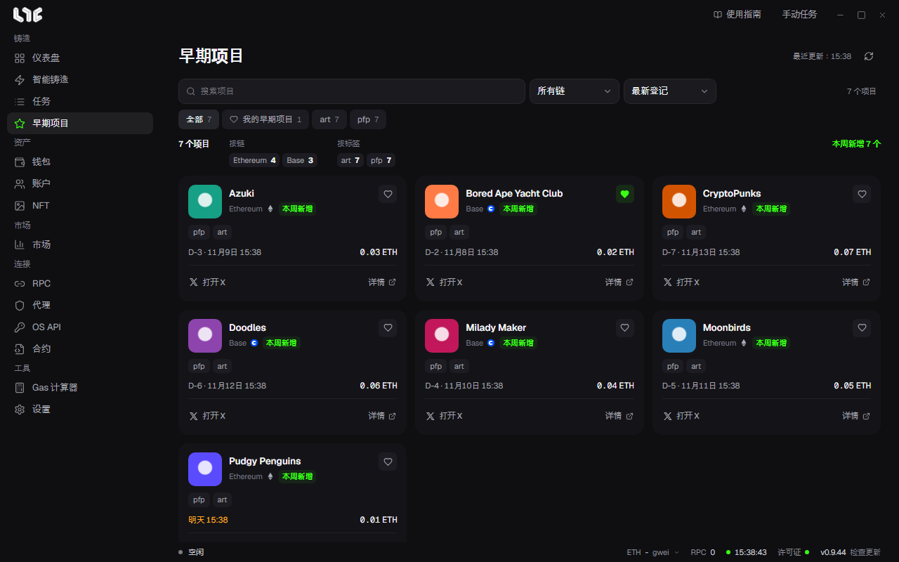

# 早期项目

早期项目是 Nogada 运营者登记的项目列表。右上方显示最近获取的时间，旁边的按钮可以重新获取。

## 筛选与排序

- 搜索栏：按项目名称查找。
- **所有链**：按链筛选。
- 排序：**最新登记**、**最近铸造**、**名称 A–Z**。
- 按钮：**全部**、**我的早期项目**（点了爱心的项目），以及各个标签。

按钮下方一行显示当前筛选出的项目数、按链和按标签的数量，以及本周新增的数量。

## 看懂卡片

| 标记 | 含义 |
|---|---|
| 本周新增 | 本周登记的项目。 |
| 日期与 D-N | 铸造日期和时间。今天或明天会显示为 **明天 22:26** 这样的形式。 |
| 价格 | 已知的铸造价格。 |
| 爱心 | 点击加入或移出我的早期项目。 |
| 打开 X、详情 | 打开项目的 X 或详细信息。 |
