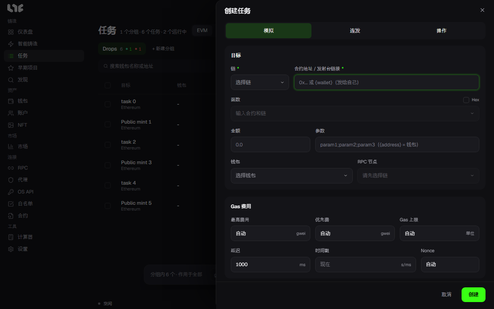

# 创建任务

点击 **任务 → EVM → 新建任务**，会打开 **创建任务** 窗口。下面逐栏说明各自的作用。

## 合约地址 / 发射台链接

| 填入的内容 | 会发生什么 |
| --- | --- |
| 合约地址 | 查找 ABI 并显示函数列表 |
| OpenSea Drop 链接 | 查找 Drop、阶段和价格并自动填入。见 [OpenSea Drop](opensea.md) |
| Transient、Blever、Scatter、Verse、MintBay、Ronin Market 链接 | 查找铸造信息并自动填入 |

找不到 ABI 时，请手动粘贴 ABI，或改用 Hex。

## 函数与 Hex

- **函数**：只显示会改变状态的函数。选择函数后填写参数。需要为每个钱包填不同的值时很合适。
- **Hex**：原样发送调用数据。适合内容始终相同的交易。

## 参数

按顺序用分号隔开函数的各个输入。例如：`2;0xabc…;[1,2,3]`。个数必须和函数一致。

### 占位符

| 写法 | 含义 |
| --- | --- |
| `{address}` | 任务钱包的完整地址（`0x…`）。地址参数通常用这个 |
| `{wallet}` / `{self}` | 签名钱包的地址，去掉 `0x` 的 40 位小写。在参数和 Hex 里使用；填入合约栏时，表示发送给自己 |
| `{id}` / `{idN}` / `{idA-B}` | 查找可用的代币 ID。`{id777}` 是 0~777，`{id100-777}` 是该范围 |
| `{n}` / `{nN}` / `{nA-B}` | 通过模拟找出调用能成功的数字。`{n777}` 是 1~777 |

只要用了 `{id…}` 或 `{n…}`，任务就固定为模拟，不能再使用连发。

## 金额

这是每笔交易发送的原生代币 **总额**，不是单价。免费或不能接收代币的调用，填 0 或留空。普通的付费铸造，填铸造价格 × 数量。受支持的发射台由应用自动填入。

## 钱包与 RPC

选择钱包分组和钱包。一个钱包就是一个任务。开启 **仅有余额** 后，只显示有余额的钱包。

也可以不选 RPC 节点。默认会使用该链的所有 RPC 节点。见 [RPC](../setup/rpc.md)。

## Gas

留空即为自动。详情见 [Gas](gas.md)。

- **Gas 上限**：通常留空。手动填入可以省掉一次调用，但太低会失败。
- **最高费用**：愿意支付的最高 gwei。
- **优先费**：为了被打包而支付的小费。不能大于最高费用。

## 时间

- **延迟**：重试间隔（ms）。
- **时间戳**：Unix 时间。会等到那个时间再启动。连发时可以写成 `开始-结束`。
- **Nonce**：通常留空。只有想针对钱包的某个特定 nonce 时才使用。

时间戳可以在[计算器](../tools/calculator.md)里转换。

## 模式

窗口上方的 **模拟** 和 **连发** 可以开关。两个都关闭时，立即发送。见[任务模式](modes.md)。

## Flashbots

只在以太坊主网上使用。开启后，同一笔已签名的交易也会以捆绑包的形式提交。设为仅私有时，会跳过公共内存池。在连发中，它会变成仅捆绑包的路径，未打包的捆绑包不会消耗 Gas，也不会消耗 nonce。使用的是 **设置 → 发射引擎** 里的值。

## 操作：铸造之后要做的事

开启窗口上方的 **操作** 后，可以设定铸造被确认之后要做的事。连发中不能使用。

| 操作 | 设定的内容 |
| --- | --- |
| 发送 NFT | 目的地、转移费用。用 **NFT 转移后转出剩余 ETH** 还可以把剩余的 ETH 也转出 |
| 上架 NFT | OpenSea 价格和期限。需要 OpenSea API 密钥 |
| 接受报价 | 最低 WETH 报价。需要 OpenSea API 密钥 |

使用在白名单市场上买来的钱包时，铸造后立即把 NFT 和 ETH 转到你自己的钱包，会更安全。

## 创建顺序

1. 填入合约或链接。
2. 选择函数，或改用 Hex。
3. 填写参数和金额。
4. 选择钱包和 RPC。
5. 设置 Gas 和时间。Gas 通常保持自动即可。
6. 选择模式。
7. 点击 **创建**，然后启动。任务会以待处理状态创建。
