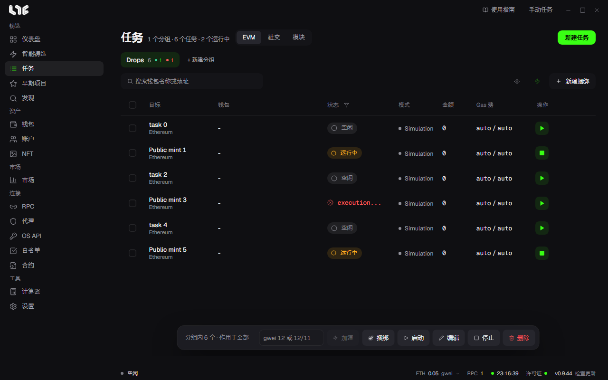

# 任务与模块

**任务** 页面是应用的核心。分组把任务归在一起，每一行则是实际启动、停止、重试和记录日志的单位。

## 标签页

| 标签页 | 行的含义 |
| --- | --- |
| EVM | 一个钱包执行一份交易设置 |
| 社交 | 一个账户执行一份社交设置 |
| 模块 | 选择运营者上传的任务模板 |

## 分组与行

- 用 **+ 新建分组** 按系列、市场或流程来归类。
- 每个钱包生成一行。
- 状态显示为待处理、运行中、已停止、成功、失败等。
- 在行的 **更多任务操作** 里可以复制、查看日志、删除。日志会显示与该任务相关的 `logs/nogada.log` 行。
- 运行中的任务不能编辑。请先停止。

底部栏的 **启动**、**停止**、**编辑**、**删除**、**捆绑**、**加速** 作用于所选的行；没有选行时，作用于整个分组。编辑只对已停止的任务有效。

## 创建任务的三种方式

- [智能铸造](smart-mint.md)：只要填入链接。大多数情况用这种方式就够了。
- [创建任务](onchain.md)：用 **新建任务** 自己填写各个栏位。要直接发送函数调用或 Hex 时使用。
- **快速任务**：用设置里设好的钱包和 RPC 直接创建。

无论哪种方式，只创建任务是不会发射的。必须点击启动。

## 模块

模块是运营者上传到服务器的任务模板，把你要自己创建的任务预先填好了。

| 模块 | 创建的内容 |
| --- | --- |
| 链上 | 已填好合约、链、函数或 Hex、Gas、金额的任务 |
| 社交 | 使用固定 HTTP 或浏览器流程的社交任务 |

在 **任务 → 模块** 里选择。通常只需要修改你自己的设置，比如钱包、RPC 和费用。合约、函数或 Hex、金额，除非运营者另有说明，否则不要修改。

如果上传了新模块却看不到，请点击 **刷新模块**。不需要重新启动应用。
