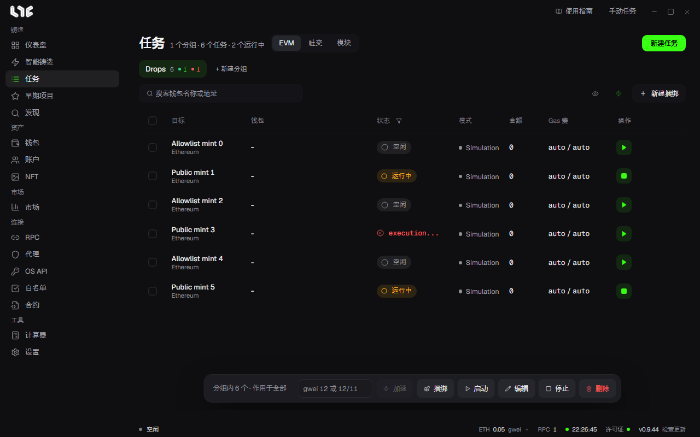

# 运行任务与加速

创建好的任务按分组汇集在 **任务** 中。在这里启动、停止任务，查看结果，并提高已发送交易的 Gas。

## 页面上方

- **EVM / 社交 / 模块** 标签：铸造任务在 EVM 标签里。社交和模块见 [账户与社交任务](../social/accounts-and-social.md)。
- 标题旁的数字：分组数、任务数和当前运行中的任务数。
- **分组按钮**：点击打开该分组。按钮上的数字是任务数，绿点是成功数，红点是失败数。按住 Shift 点击可以选择多个分组，拖动可以调整顺序。
- **新建任务**：打开 [手动创建任务](task-form.md) 窗口。

搜索栏右侧的三个按钮：

| 按钮 | 作用 |
|---|---|
| 眼睛 | 隐藏或显示钱包列和 Gas 列。 |
| 闪电 | 打开 **快速任务**。见下文。 |
| 新建捆绑 | 创建把多个钱包打包成一笔交易的捆绑任务。→ [捆绑与合约](bundles.md) |

## 看懂表格

| 列 | 含义 |
|---|---|
| 目标 | 任务名称和链。 |
| 钱包 | 该任务使用的钱包。 |
| 状态 | 空闲、运行中、成功、失败及原因。用列标题的漏斗按状态筛选。 |
| 模式 | 模拟、连发等发射方式。 |
| 金额 | 每笔交易发送的币。 |
| Gas 费 | 最高费用 / 优先费。auto 表示自动。 |
| 操作 | ▶ 启动，■ 停止。鼠标悬停在行上会出现编辑、删除和 **⋯**。 |

**⋯** 菜单中有 **复制**（用相同设置打开新任务窗口）、**显示日志** 和 **删除**。运行中的任务不能编辑，请先停止。

## 启动与停止

- 点击行的 ▶ 只启动该任务。
- 底部栏的 **启动** 一次启动多个任务。
- 有时间戳的任务启动后会等到那个时间再发送。
- 点击 **停止** 即停止。已经发到网络的交易无法撤回。

任务在应用内运行。关闭应用后，等待中的任务也会一起停止。

## 底部栏

底部栏作用于当前可见的全部任务，或只作用于所选任务。

- 什么都没选时显示 **分组内 N 个 · 作用于全部**，分组中可见的所有任务都是对象。
- 勾选后显示为已选 N 个，只对所选任务生效。

| 按钮 | 作用 |
|---|---|
| gwei 栏 + 加速 | 修改 Gas。见下面的“加速”。 |
| 捆绑 | 把所选任务合成一个捆绑。 |
| 启动 / 停止 | 启动或停止对象任务。 |
| 编辑 | 一次修改对象任务。留空的栏位保持各任务当前的值。 |
| 删除 | 删除对象任务。 |

## 加速

已发送的交易因 Gas 太低卡住时使用。在底部栏的 gwei 栏中只写一个数，例如 `12`，表示最高费用和优先费都是 12；写 `12/11` 表示最高费用 12、优先费 11。然后点击 **加速**。

每个任务这样处理：

| 任务状态 | 加速的作用 |
|---|---|
| 已发送的交易仍在等待 | 用相同 nonce、新 Gas 发送一笔交易来替换。任务的 Gas 设置也改为新值。 |
| 尚未发送，或没有等待中的交易 | 只修改任务的 Gas 设置。下次发送时使用。 |
| 已经结束 | 跳过。 |

如果原交易先被确认，替换交易什么也不会做，也不会重复扣费。应用不会自行提高 Gas，只有点击加速时才会提高。

## 显示日志

行的 **⋯ → 显示日志** 打开该任务的记录。上方汇总钱包、Gas 费、金额和模式，在筛选栏输入 `FAIL`、`revert` 或钱包名称等可以过滤行。用 **全部复制** 复制记录，咨询时粘贴。

同样的记录也保存在 exe 旁边的 `logs/nogada.log`。

## 快速任务

闪电按钮会用事先设好的钱包和 RPC 打开任务窗口。窗口标题是 **快速任务**，钱包和 RPC 栏由已保存的值代替，也没有延迟、时间戳和 Nonce 栏：分别使用默认延迟、立即发送和自动 nonce。

- 在 **设置 → 快速任务设置 → 快速任务钱包** 中选择钱包。一个都没选时闪电按钮不可用。
- 在同一页面的 **快速任务 RPC（按链）** 中按链设置 RPC。没有设置的链使用该链保存的全部 RPC，没有的话使用公共默认值。

创建的快速任务和其他任务一样在表格中启动。

## 失败时

- 先看状态列的原因和日志。
- 余额不足时，补充币后重新启动。
- 因阶段尚未开放而失败时，开启模拟，或把时间戳设为开放时间。
- 常见提示汇总在 [遇到问题时](../help/when-stuck.md)。
