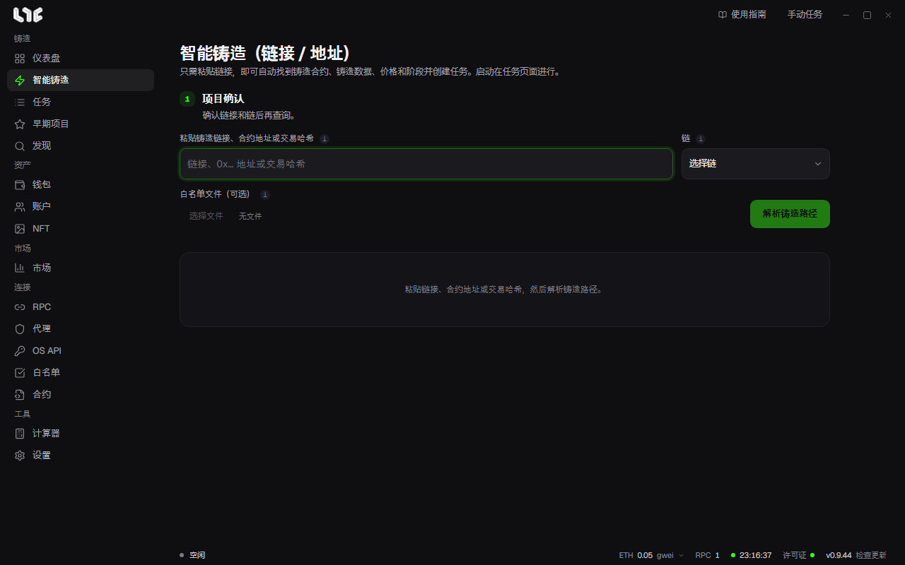

# 智能铸造

只用一个链接，就能找到铸造合约、铸造数据、价格和阶段，并创建任务的页面。这是 Nogada 独有的功能。查询或选择阶段都不会发射。启动要在任务页面里进行。

## 可以填入的内容

- 合约地址
- 区块浏览器链接
- 市场和发射台链接
- 项目铸造网站链接
- 铸造交易哈希，或区块浏览器的交易链接

链需要你自己选择。同一个地址可能存在于多条链上，所以应用不会自动切换。

## 步骤

1. 选择链，粘贴输入内容，点击 **解析铸造路径**。
2. 选择 **阶段**。显示的是项目所用的原名。应用不会替你选择。
3. 在 **执行设置** 里设置钱包、数量、Gas、发射方式、代理和铸造后的操作。
4. 在 **最终确认** 里查看内容并创建任务。
5. 在 **任务** 页面里点击启动。

## 页面上会出现的内容

- **铸造函数**：显示找到的函数及其依据。如果有多个候选，从列表中选择。
- **价格**：同时显示读取来源。绿色的值是参考值。直接在合约上铸造的 Drop，需要自己输入价格后重新查询。
- **未公开与未确认**：项目在开放时才公布的值，不会猜着填，而是显示为未公开。开放之后重新查询，就会填上。
- **路径查询来源**：显示读取了哪些来源，以及什么失败了。

## 白名单文件

如果是默克尔方式的阶段，可以在 **白名单文件（可选）** 中填入 CSV 或 OpenZeppelin JSON。最大 4 MiB。应用会把它和当前链上的根与证明做对照。

## 发射方式

| 方式 | 作用 |
| --- | --- |
| 即时 ×1 | 为每个钱包各发送一次已准备好的交易 |
| 连发（重复） | 按设定的间隔重复。直到铸造被确认、达到上限或你手动停止才结束 |
| 安全（先模拟） | 发送前先模拟，只跳过预计会失败的钱包 |

如果要对尚未开放的阶段提前启动，推荐使用连发。在你自己选择之前，方式不会改变。详细对比见[任务模式](modes.md)。

## 查询失败时

即使链接正常，也可能因为网站保护或地区限制而无法读取。请按下面的顺序尝试。

1. 填入同一项目的 OpenSea 系列链接或区块浏览器链接。
2. 填入真正的铸造合约或 NFT 合约地址，并选对链。
3. 填入项目的铸造页面链接。可以用网站的 ABI 找到函数名称。
4. 在[创建任务](onchain.md)里，用 ABI 或 Hex 手动创建。

错误末尾的 `(R-…)` 代码表示原因。咨询时请一并发送。

## 网站按钱包发放签名的 Drop

如果 Drop 要求的签名是应用无法生成的，应用会明确告知。请直接在项目网站上铸造；如果是受支持的网站，就把铸造网站的链接填入智能铸造。
