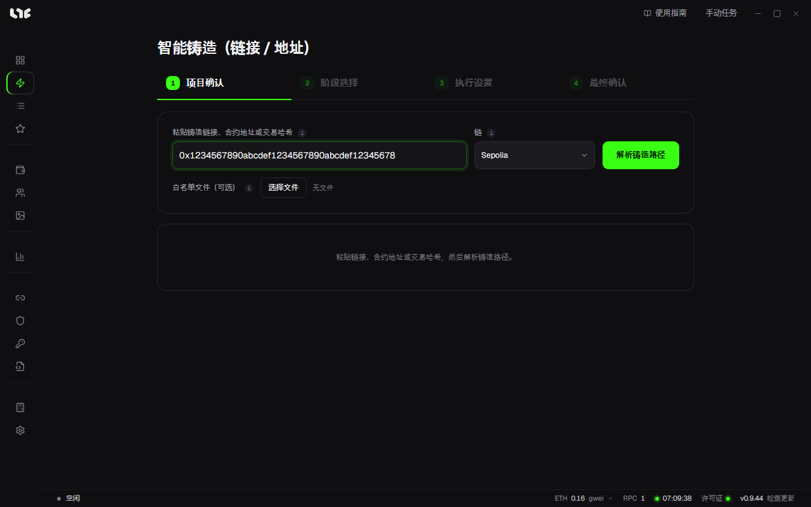
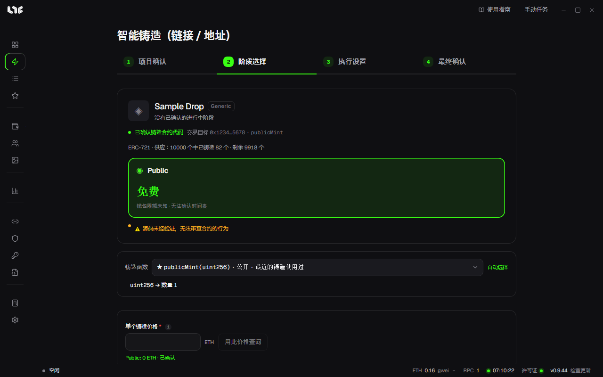
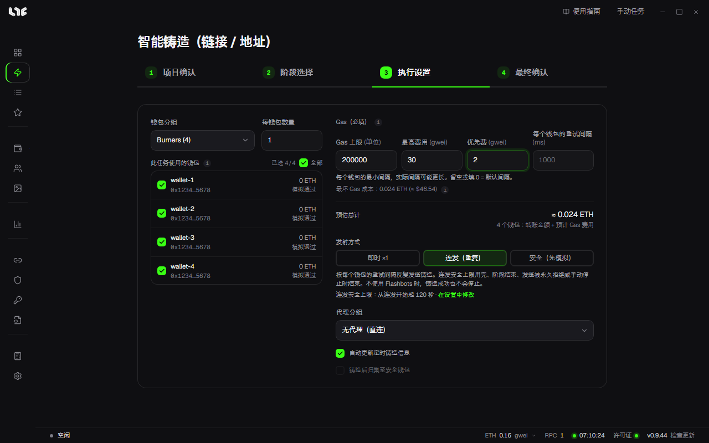
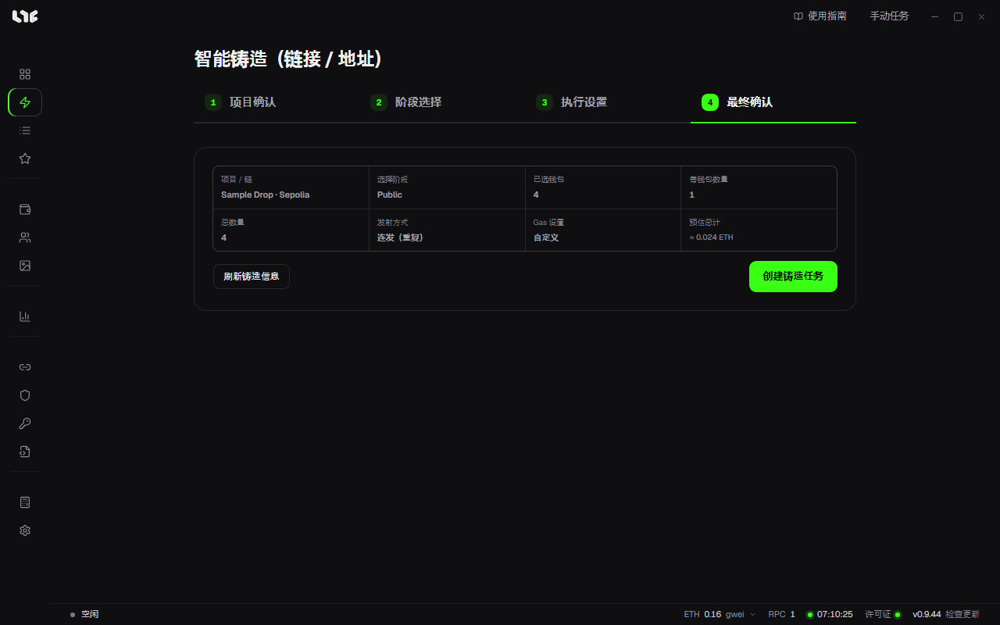

# 智能铸造

智能铸造用一个链接创建铸造任务。应用会找出铸造合约、要调用的数据、价格和阶段，你只需选择钱包和发射方式。任务创建后在 **任务** 页面启动。

页面用四个步骤标签（**项目确认**、**阶段选择**、**执行设置**、**最终确认**）一次只显示一个步骤。查询完成前只能使用第一个标签，查询完成后会跳到 **阶段选择** 标签。之后可以点击标签在各步骤之间来回切换。

## 1. 项目确认

在 **粘贴铸造链接、合约地址或交易哈希** 中填入下面任意一种：

- 项目的铸造页面、发射台链接、交易市场链接
- 合约地址、区块浏览器中的合约链接
- 有人铸造该 Drop 的交易哈希或区块浏览器交易链接

**链** 需要自己选择。同一个地址可能存在于多条链上，所以应用不会自动切换。

有白名单名单文件的话，放到 **白名单文件（可选）**。支持 CSV 或 OpenZeppelin JSON，最大 4 MiB，并与当前链上的 Merkle 根核对。

点击 **解析铸造路径** 或在栏位中按 Enter，查询期间会显示 **解析中…**。如果有多个合约符合链接，会让你选择要查询哪一个。填入交易哈希时，会出现选择用该交易核对哪些钱包的栏位。

## 2. 阶段选择

页面会显示项目名称和平台、铸造函数、供应量和阶段列表。每个阶段显示价格（免费时显示 **免费**）、每钱包限额和时间。点击要铸造的阶段。

可能出现以下提示：

- **源码未验证的警告**：合约代码没有公开验证，应用无法读懂它做什么。仍然可以铸造，但请自己确认项目是否可信。
- **无法读取铸造价格**：填入单个代币的铸造价格，点击 **用此价格查询**。读到的价格只是参考值时也会出现同样的栏位。手动填写的价格会原样用到发射。
- **原生手续费**：无法确认与代币价格一起支付的手续费时，会要求填写单个代币的手续费。没有就填 0。
- **销售尚未开放**：开放前链上不会确认铸造调用。应用会自动重新查询，开放后补齐。
- ERC-1155 的 Drop 会出现 **代币 ID** 栏。留空则使用链接中的 ID。0 也是有效 ID。

## 3. 执行设置

| 栏位 | 设置内容 |
|---|---|
| 钱包分组 | 用于铸造的钱包分组。 |
| 每钱包数量 | 每个钱包铸造的数量。Drop 有每钱包限额时会一起显示。 |
| 此任务使用的钱包 | 勾选分组中要使用的钱包。每个钱包旁显示余额和检查结果（例如模拟通过）。 |
| Gas | Gas 上限、最高费用、优先费。见下面的“Gas 栏位”。 |
| 预估总计 | 所选全部钱包的转账金额加预计 Gas 费。实际 Gas 在发射时确定。 |
| 发射方式 | 见下表。 |
| 模式 | 只有 OpenSea 的 Drop 才会出现。见下面的“OpenSea Drop 的模式”。 |
| 代理分组 | 至少建过一个代理分组时才会出现。签名铸造数据的请求会经过该分组的代理（每个 IP 最多 20 个钱包），只有所有代理都失败时才由这台电脑直接请求。交易总是从这台电脑发送。默认是 **无代理（直连）**。 |

### Gas 栏位

- 选择 **即时 ×1** 和 **连发（重复）** 时，标题显示 **Gas（必填）**。Gas 上限、最高费用、优先费都要填数字，才能创建任务。
- 选择 **安全（先模拟）** 时会变成 **Gas（留空 = 自动）**。留空由应用决定，填写则按所填值使用。

### 发射方式

| 方式 | 作用 |
|---|---|
| 即时 ×1 | 任务启动后，每个钱包把准备好的交易发送一次。 |
| 连发（重复） | 按设定的间隔持续发送。达到上限（例如时间范围结束或连发安全上限）、返回重试也无法解决的错误，或手动停止时结束。不使用 Flashbots 时，铸造成功一次也不会让它停下。 |
| 安全（先模拟） | 发送前先模拟，只跳过预计会失败的钱包。不保证成功。 |

选择连发后会多出 **每个钱包的重试间隔** 栏位：同一个钱包再次发送前的最短间隔。留空或 0 使用默认节奏。

发射方式下方会显示连发何时停止，以及当前的 **连发安全上限**（从连发开始起多少秒，关闭时显示已关闭）。点击旁边的 **在设置中修改**，会打开 **设置 → 发射引擎 → 任务 → 连发安全上限** 栏位。

阶段稍后才开放时，连发按钮旁会出现 **推荐**。意思是如果想提前启动、开放瞬间立即发送，适合用连发。在你亲自选择之前，发射方式不会改变。

### OpenSea Drop 的模式

OpenSea 的 Drop 会出现 **模式** 栏位，用来决定如何获取每个钱包的签名铸造数据。

- 选择公开阶段时，栏位被锁定，任务使用应用给出的模式：已登记的 OpenSea API 密钥能获取该 Drop 时为 **OpenSea API**，否则为 **普通模式**。
- 选择非公开阶段（白名单等）时，栏位为空，显示 **请选择模式**，亲自选择之前无法创建任务。
- 可选 **OpenSea API**、**双模式**、**普通模式**、**匿名模式**。前两个只有在 OpenSea API 密钥能获取该 Drop 时才能选。一个密钥都没有时，栏位名称旁会显示 **需要 OpenSea API 密钥**。每种模式的作用见 [手动创建任务](task-form.md) 的“填入发射台链接时”。

Highlight 的签名 Drop 会出现栏位，用来粘贴从 highlight.xyz 获取的每个钱包的签名铸造数据。留空则在任务启动时重新获取。

### 两个复选框

- **自动更新定时铸造信息**：开启后，定时任务会在开始前把价格、阶段和铸造数据更新到最新。准备在发射时间前完成，所以不会推迟发射。
- **铸造后归集至安全钱包**：铸造成功后，立即把获得的 NFT 和剩余币转到你填写的安全钱包。连发不能使用。

Stable 链上的 Drop 不能选择连发，**自动更新定时铸造信息** 始终开启。

## 4. 最终确认

一次显示项目和链、阶段、所选钱包数、每钱包数量、总数量、发射方式、Gas 设置和预估总计。确认无误后点击 **创建铸造任务**。想重新读取信息时点击 **刷新铸造信息**。

如果缺少内容（阶段、钱包、模式、Gas 等），不会创建任务，而是回到有该栏位的步骤标签并说明原因。

任务创建后会出现 **前往任务** 按钮。为稍后开放的阶段创建的任务，以该阶段的开放时间为开始时间；在任务页面启动后会在那个时间发送。为已经开放的阶段创建的任务没有开始时间，启动后立即发送。→ [运行任务与加速](running.md)

## 查询失败时

| 提示 | 怎么做 |
|---|---|
| R-RPC | 无法连接链或项目服务器。检查 [RPC](../prepare/rpc-and-chains.md) 后重试。 |
| R-LINK | 无法读取链接。检查 URL，或直接粘贴铸造合约地址。 |
| R-RESOLVE | 找不到铸造路径。重试，或用 **使用 ABI / Hex** [手动创建任务](task-form.md)。 |
| 该链没有 RPC | 在 RPC 页面添加该链的 RPC。 |
| 该地址不是合约 | 填入的是钱包地址。请确认铸造合约地址。 |

下方的 **最近查询** 会保留查询过的项目。点击即可重新查询，**清空列表** 清除列表。
