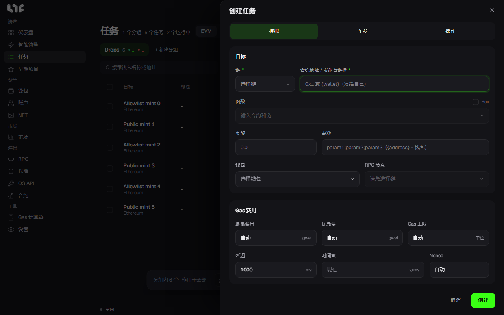
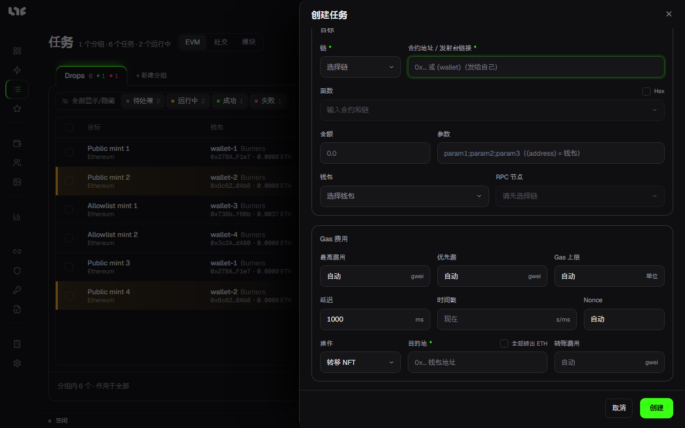

# 手动创建任务

智能铸造找不到路径，或者你想自己指定合约和函数时，使用这个窗口。在 **任务** 页面点击 **新建任务**，或点击顶部栏的 **手动任务** 打开。需要先有一个任务分组（**+ 新建分组**）。

## 何时、如何发送

窗口顶部的三个按钮决定任务怎样发送。

| 按钮 | 开启后 |
|---|---|
| 模拟 | 发送前先尝试同样的调用。尝试失败（revert）时等待 **延迟** 设定的时间再试，一旦通过就发送。适合等铸造开放后再发射。 |
| 连发 | 按设定的间隔持续发送交易，直到出现以下任一情况才停止：手动停止、时间范围结束、达到 **最大交易数**、**设置 → 发射引擎 → 连发安全上限** 用完，或返回重试也无法解决的错误。 |
| 操作 | 添加铸造完成后要做的事。见下面的“铸造之后”。 |

模拟和连发不能同时开启。两者都关闭时，会在设定的时间发送一次。开启连发后不能使用操作，而且最高费用、优先费和 Gas 上限不能用自动，必须填写数字，这些栏位旁会出现红色星号。

与时间有关的栏位：

| 栏位 | 含义 |
|---|---|
| 时间戳 | 发送时间。留空则启动后立即发送。填写以秒或毫秒为单位的 Unix 时间后，栏位名旁会显示还有多久。连发时可以填 `开始-结束` 这样的范围，只在这段时间内发送。 |
| 延迟 | 重试前或连发下一笔交易前的等待时间（ms）。新任务会使用 **设置 → 发射引擎 → 默认延迟**。 |
| Nonce | 通常留空（自动）。只有必须指定某个 nonce 时才填数字。开启连发后这一栏会变成 **最大交易数**，留空表示不限。 |

要把日期和时间换成 Unix 时间，使用 [Gas 计算器](../app/calculator.md) 中的 **Unix 时间转换**。发射时间按这台电脑的时钟计算。

## 调用什么

| 栏位 | 填写内容 |
|---|---|
| 链 | 要铸造的链。 |
| 合约地址 / 发射台链接 | 铸造合约地址，或发射台上的 Drop 链接。写 `{wallet}` 表示每个钱包发给自己的地址。 |
| 函数 | 合约代码经过验证时，会列出可调用的函数。选择后参数栏会相应调整。 |
| Hex | 开启后，不选函数而是直接填写原始调用数据（以 0x 开头）。用于代码未验证的合约。 |
| 金额 | 每笔交易一起发出的币量。免费铸造填 0。 |
| 参数 | 函数参数用 `;` 分隔。写 `{address}` 的位置会替换成每个钱包的地址。 |

### 填入发射台链接时

在合约栏填入发射台的 Drop 链接，窗口会切换成适合该发射台的样子。会出现选择 **铸造阶段** 的栏位，选好阶段后时间戳会自动填为该阶段的开始时间。

OpenSea 的 Drop 会出现以下栏位：

- **模式**：选择如何获取每个钱包的签名铸造数据。
  - **普通模式**：每个钱包登录 OpenSea 后获取。
  - **匿名模式**：不登录，通过任务的代理获取。只对没拿到数据的钱包使用 API 密钥。
  - **OpenSea API**：用 OS API 中的密钥获取。有密钥才能选择。
  - **双模式**：同时通过普通模式和 OpenSea API 请求，采用先返回的结果。有密钥才能选择。
  - 一个密钥都没有时，栏位名称旁会显示 **需要 OpenSea API 密钥**。
- **API 通道**：只有 OpenSea API 和双模式可以选择。
- **OpenSea 路由**：左边是要使用的 OS API 密钥分组（**全部** 表示所有密钥），右边是请求经过的代理分组。双模式下栏位名称旁会出现 **将 API 路由到代理** 开关，开启后 API 请求也会经过代理。
- **NFT 数量**：每个钱包铸造的数量。有每钱包限额时会显示在旁边。
- **每 NFT 价格**：单个 NFT 愿意支付的最高价格。如果发射时 OpenSea 给出的价格更高，任务会停止而不发送。

## 用哪些钱包、经过哪些 RPC

| 栏位 | 填写内容 |
|---|---|
| 钱包 | 要使用的钱包。开启 **仅有余额** 时列表只显示有余额的钱包。选中的每个钱包都会各自生成一个任务，放在同一个分组里。 |
| RPC 节点 | 这个任务使用的 RPC。分配方式见 [RPC 与链](../prepare/rpc-and-chains.md)。 |

## Gas

| 栏位 | 含义 |
|---|---|
| 最高费用 | Gas 单价的上限（gwei）。留空为自动。 |
| 优先费 | 给出块者的小费（gwei）。留空为自动，并乘以 **设置 → 发射引擎** 中的 **自动小费倍数**。 |
| Gas 上限 | 一笔交易最多可用的 Gas。留空由应用估算。 |
| Flashbots | 只在以太坊上显示。开启后交易不进入公共交易池，只作为 Flashbots 捆绑提交。 |

同时开启 Flashbots 和连发时，延迟栏会变成 **滚动窗口**，最大交易数栏会变成 **成功 / 结束 / 停止**。此时连发会一直持续，直到成功、到达时间戳范围的结束、手动停止或达到连发安全上限。捆绑窗口的大小在 **设置 → 发射引擎 → Flashbots** 中设置。

## 铸造之后

开启 **操作** 后，窗口下方会出现栏位。铸造成功后在该钱包中执行。

| 操作 | 栏位 | 作用 |
|---|---|---|
| 转移 NFT | 目的地、全部转出 ETH、转账费用 | 把铸造到的 NFT 转到目的地地址。开启 **全部转出 ETH** 后，转出 NFT 之后剩余的币也会全部转出。 |
| 上架 NFT | 上架价格、到期 | 把铸造到的 NFT 以该价格上架到 OpenSea。到期可选 1 小时到 30 天。需要 OpenSea API 密钥。 |
| 接受报价 | 最低报价、Gas 费 | 接受铸造到的 NFT 上的最高报价。最低报价留空则接受任何报价。需要 OpenSea API 密钥。 |

## 创建

点击 **创建** 后任务进入分组，此时还不会发送。启动方法见 [运行任务与加速](running.md)。

该链没有保存 RPC 时，下方会显示 **无 RPC，使用公共 RPC**，按钮变为 **确认**。可以接受公共 RPC 就点击它；否则先添加 RPC。
