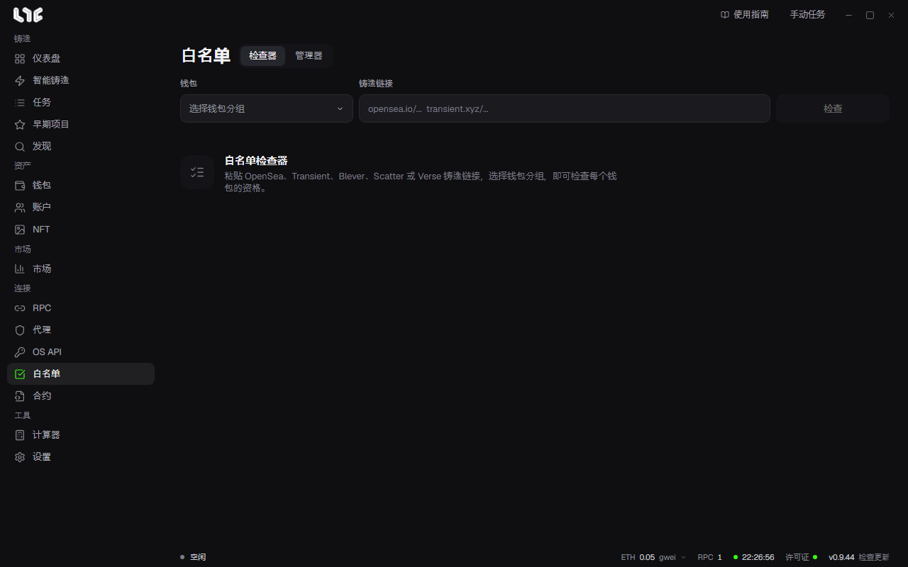

# 白名单

项目公布白名单后，把 Drop 链接粘贴到 **检查器**，就能看到你的哪些钱包入选了。第二个标签 **管理器** 是你自己记录已入选项目的列表。

## 检查一个 Drop

1. 在 **钱包** 中选择钱包分组。
2. 在 **铸造链接** 中粘贴 OpenSea、Transient、Blever、Scatter 或 Verse 的 Drop 链接。
3. 点击 **检查**。
4. 每个阶段会出现一行，标出每个钱包有没有资格。用这一行上的按钮进行下一步，鼠标悬停在按钮上会显示名称。

| 按钮名称 | 作用 |
|---|---|
| 为此阶段符合条件的钱包创建铸造任务 | 只用有资格的钱包创建任务。 |
| 复制此阶段符合条件钱包的地址 | 复制有资格的钱包地址。 |
| 复制此阶段钱包的私钥 | 复制这些钱包的私钥。 |
| 向此阶段的钱包分发资金 | 给这些钱包分发 Gas。 |
| 将符合条件的钱包保存到管理器 | 把有资格的钱包保存为管理器中的一个条目。 |

## 检查大量钱包时

检查 OpenSea 白名单时，每个钱包都要登录 OpenSea 查询资格。没有代理时，这台电脑会直接检查，每次只同时查几个钱包。开启 **设置 → 发射引擎 → 白名单检查器代理** 并选择代理分组后，会通过代理同时检查最多 50 个钱包。在代理上反复失败的请求会从这台电脑直接重试。

## 管理器

管理器记录你已入选的项目及其钱包。在检查器中点击 **将符合条件的钱包保存到管理器** 会生成条目，也可以用 **+ 添加** 自己填写。

| 栏位 | 填写内容 |
|---|---|
| 状态 | **白名单**（已获得名额）或 **进行中**（已申请，等待结果）。 |
| 项目名称 | 必填。 |
| X 链接 | 项目的 X 地址。必填。 |
| 网站 / OpenSea | 可选。 |
| 铸造 / 截止日期 | 铸造或申请截止的日期和时间。 |
| 每钱包数量 | 每个钱包可以铸造的数量。 |
| 链、钱包 | 可选。 |

用列表上方的 **全部**、**白名单**、**进行中** 按状态筛选，在搜索栏中按项目名称查找。展开条目可以看到钱包列表，用铅笔编辑，用垃圾桶删除。
