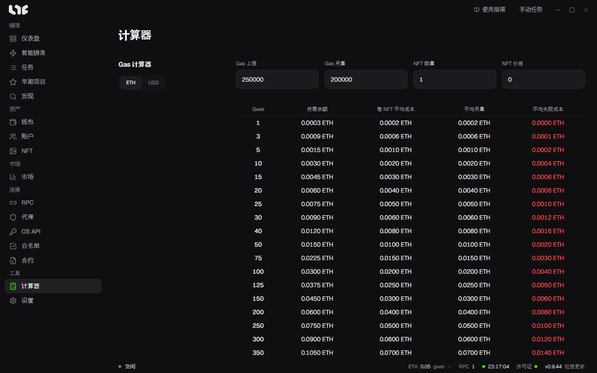

# 计算器

**计算器** 里有 Unix 时间转换和 Gas 计算器。两者都只在这台电脑上运行。

## Unix 时间转换

改一边，另一边会跟着变化。

- **Unix 时间戳**：以秒为单位。填入毫秒时会换算成秒。
- **本地日期和时间**：使用电脑的时区。

用 **设为现在** 填入当前时间。把复制的值填入任务的 **时间戳** 栏。

## Gas 计算器

按固定的 gwei 值，用表格显示各自的成本。它不是实时的基础费用估算器。

| 输入 | 含义 |
| --- | --- |
| Gas 上限 | 为一笔交易预留的 Gas 上限 |
| Gas 用量 | 铸造成功时使用的 Gas |
| NFT 数量 | 要铸造的 NFT 数量 |
| NFT 价格 | 一个 NFT 的原生代币价格 |

| 结果 | 计算 |
| --- | --- |
| 所需余额 | NFT 成本 + 1.2 × 上限 Gas 成本 |
| 每 NFT 平均成本 | 平均用量 ÷ NFT 数量 |
| 平均用量 | NFT 数量 × NFT 价格 + 成功 Gas 成本 |
| 平均失败成本 | 在该 gwei 下失败交易的 Gas 成本估算 |

铸造前，用它算出每个钱包要存入的金额。用 **USD** 按钮切换为美元显示。
