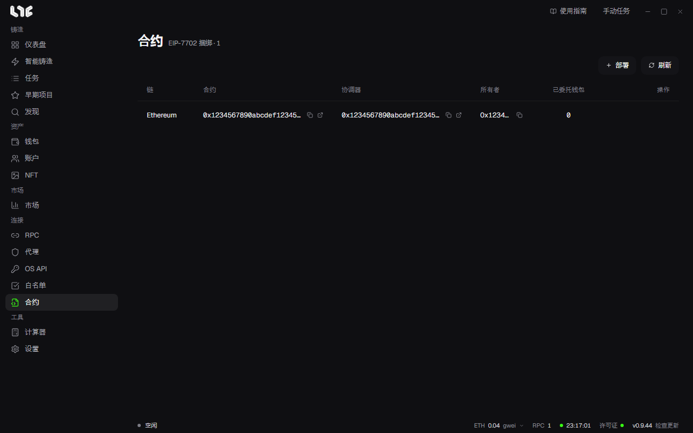

# 合约

**合约** 是 EIP-7702 捆绑工作区。它保存协调器和执行器的部署记录，并协助钱包委托。它不是普通的合约地址簿。

使用捆绑，可以把多个钱包的交易作为一组发送。在任务页面用 **新建捆绑** 创建。

## 部署捆绑器

点击 **部署**，并选择以下内容。

- 链
- 至少有一个能响应的 RPC 的 **RPC 分组**
- 有资金的 **所有者钱包**
- 最高费用和优先费。留空则为自动

应用会部署协调器和执行器，每一步都会通知你，然后保存地址。**刷新** 会让保存的记录与链上状态保持一致。

## 委托与撤销

对已就绪的执行器，用 **委托钱包** 选择 EVM 钱包，并设置 EIP-7702 委托。**已委托钱包** 的数量是最近一次检查的结果。**撤销钱包委托** 会在链上清除委托。

委托决定由哪段代码代替钱包执行。签名之前，请确认链、执行器地址、钱包和 Gas。只委托给你信任的、已部署的执行器合约。

> **注意**：删除行只会删除这台电脑上的记录。已部署的合约和钱包委托保持不变。请先撤销钱包委托，在链上确认之后再删除。

## 无法部署时

请在 **RPC** 菜单里添加该链的 RPC 或对其 ping，确认所有者钱包的余额，然后再试一次。自定义链也会出现在列表里，但实际能否使用，取决于该链是否支持 EIP-7702。
