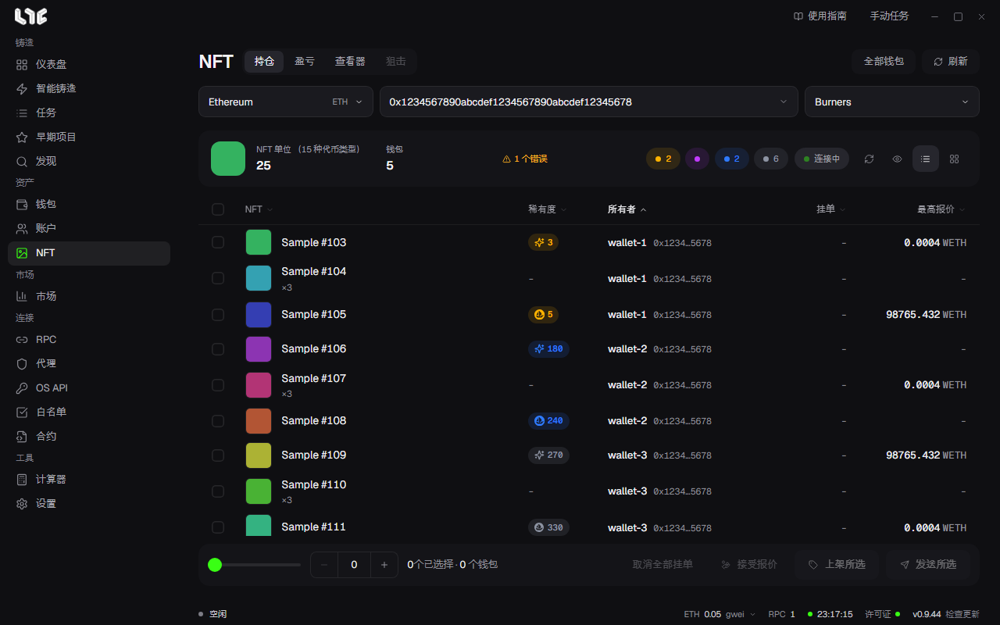

# 持仓 NFT

**NFT** 菜单里有 **持仓**、**盈亏**、**查看器** 标签页。持仓标签页显示你的钱包持有的 NFT，并可以就地发送、上架和接受报价。

## 加载

1. 选择链。
2. 选择钱包分组。可以同时选多个分组。
3. 选择系列。填入系列地址，就只读取该系列。
4. 点击刷新。

想一次读取所有钱包，请点击 **全部钱包**。它会逐条链读取，所以只有点击时才会读取。

结果顶部会显示 NFT 件数和代币种类数。两个数不同，是因为 ERC-1155。ERC-721 的一行是一个代币，ERC-1155 的一行带有数量。发送时，可以为每一行设定转移几个。

## 稀有度

排名数字的颜色表示等级。

| 等级 | 范围 |
| --- | --- |
| 传说 | 前 1% |
| 史诗 | 前 10% |
| 稀有 | 前 25% |
| 普通 | 其余 |

等级由排名 ÷ 总量决定。排名相同，总量不同，等级也不同。可以用上方的等级标签筛选。如果有 OpenSea 排名就用它，没有的话就用 Nogada 计算出的排名。

## 视图与选择

- **卡片视图**：图片网格。
- **列表视图**：以表格查看挂单价格、最高报价、稀有度和所属钱包。

点击选择，Shift+点击选择范围。可以跨钱包选择。底部栏会显示所选数量和钱包数。

- **刷新元数据**：清除已保存的名称和图片并重新下载。开图之后使用。
- **隐藏信息**：遮挡地址和钱包名称。用于截图。

## 发送、归集与分发

点击 **发送所选**。

- 关闭 **分发到各目的地**：把所选的 NFT 发到一个地方。用于把在多个钱包里铸造的 NFT 归集起来。
- 开启 **分发到各目的地**：分发到多个地方。

可以发送到你自己的钱包，或 **自定义地址**。从同一个钱包发出的转移，如果系列和链支持，会合并成一笔交易。结果按每一项分别显示，所以即使只有一部分失败，也能知道哪些没有发出去。

## 挂单与报价

需要 OpenSea API 密钥。没有密钥时，按钮会被禁用。签名始终在这台电脑上完成。

- **上架所选**：在 **创建挂单** 窗口里，把所选 NFT 上架出售。可以全部设为同一个值，也可以用 **阶梯** 逐步抬高价格。开启 **按手续费调整** 后，会抬高价格，使你到手的金额等于输入值。
- **接受报价**：对每个所选 NFT，在链上接受最好的有效报价。需要 Gas。
- **取消全部挂单**：取消所选 NFT 所属钱包在这条链上的全部挂单和报价。每个钱包发出 1 笔交易，需要 Gas。

## 为什么看不到

ERC-1155 标准无法列出钱包持有的代币。应用先通过受支持的索引器查找，再在链上确认数量。如果某条链没有索引器，不会当作空钱包处理，而是明确告知。读取失败的链会显示在上方的状态行里，最近一次读取到的 NFT 仍然保持显示。
