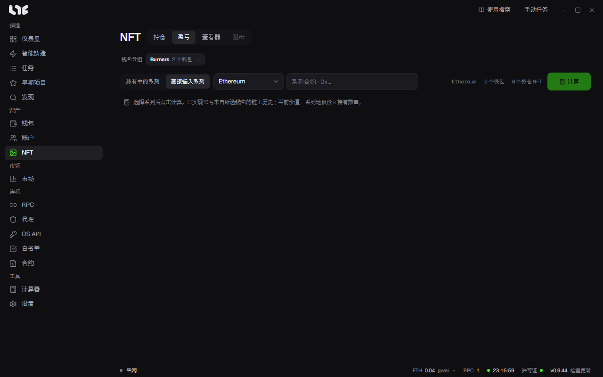

# 盈亏

**NFT → 盈亏** 计算所选钱包在某个系列上的盈亏。现在也会包含已经不再持有的钱包的记录。

## 计算

1. 选择系列。从 **持有中的系列** 里选，或用 **直接输入系列** 填入合约。
2. 选择链和钱包分组。
3. 点击 **计算**。

已实现盈亏根据所选钱包的链上记录计算。当前价值是系列地板价 × 持有数量。

交易活跃的系列可能要花一些时间。取消计算不会影响持有的 NFT。

## 需要 Alchemy

盈亏通过 Alchemy 读取交易记录。请把它填入 **设置 → 集成 → PnL Alchemy URL**，或者在 **RPC** 菜单里填入该链的 Alchemy 地址。Stable 使用 Etherscan 密钥。Alchemy 免费套餐有范围限制，记录过长时可能失败。

## 支持的链

盈亏计算有单独的链列表。即使链在应用里，也可能不支持盈亏。页面链栏里显示的就是支持的链。

## 读懂结果

- **部分记录缺失时**，该值是估算值，或不计入合计。展开说明可以看到被跳过的内容。
- **铸造成本** 是钱包在铸造交易中发送的金额，**成交** 是市场支付的金额，**持仓** 是地板价 × 数量。
- 部分结果无法复制或下载。

## 盈亏卡片

这是用来分享的卡片。可以从海报、分栏、票据、终端风格中选择，也可以放入你自己的背景图片。支持 PNG、JPG、WebP，最大 10MB，3 个槽位保存在这台电脑上。可以复制卡片，或保存为 PNG。
