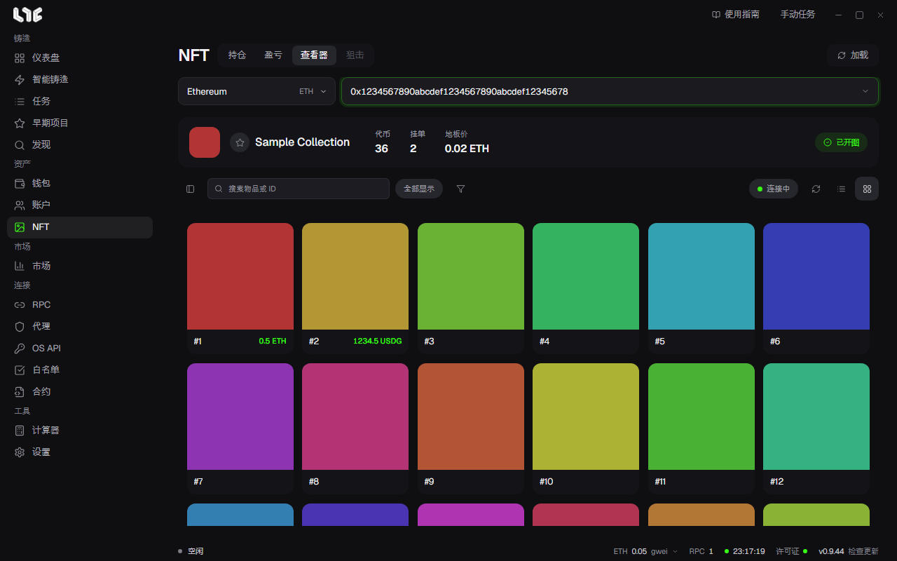

# 查看器

**NFT → 查看器** 是查看整个系列的页面，不限于你的钱包持有的东西。用来在地板价附近找稀有 NFT，或监控尚未开图的 Drop。

## 加载

粘贴系列合约，选择链，然后点击 **加载**。会同时显示代币、OpenSea 挂单和报价、稀有度和实时动态。

- 左侧 **筛选**：按是否挂单、稀有度等级、属性来筛选。
- 顶部搜索：按物品名称或代币 ID 查找。
- 切换卡片视图和表格视图，按挂单价格、稀有度、最高报价排序。
- 点击星标，加入 **收藏的系列**。

如果显示 **部分**，说明系列太大，或读取中断，只显示了一部分。请重新加载。实时更新会继续补全。

## 开图监控

在尚未开图的系列上点击 **监控开图**，应用会监视链上事件和元数据，一旦开图，就重新读取系列。

## 批量购买

选择已挂单的物品，点击购买。需要先具备下面这些。

- 至少一个 OpenSea API 密钥。见 [OpenSea API 密钥](../setup/opensea-api.md)
- **设置 → 发射引擎 → NFT 购买** 里的购买钱包
- 该钱包的 **购买最高费用**（可选）

应用会在购买之前重新确认挂单。每个 NFT 发送一笔交易，并分别告知已提交、已跳过和失败的情况。

> **注意**：批量购买只购买以原生币计价的挂单。ERC-20 挂单虽然会显示，但会被跳过。显示的挂单随时可能改变或消失，请确认价格和钱包后再点击。
