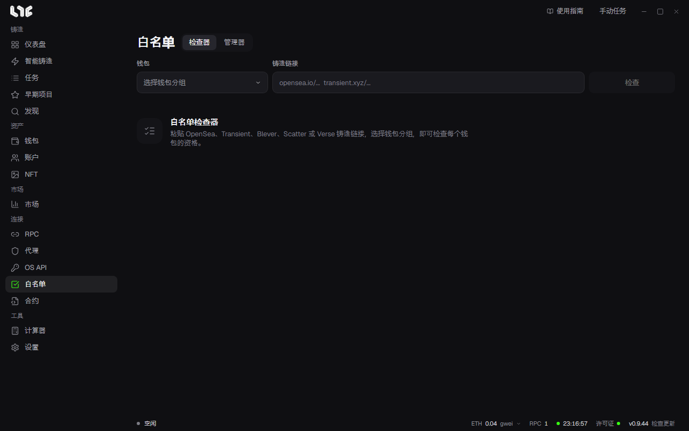

# 白名单

**检查器** 确认钱包分组对某个 Drop 是否有资格，**管理器** 保存有用的结果。

## 检查 Drop

1. 打开 **白名单 → 检查器**。
2. 粘贴 Drop 链接。支持 OpenSea、Transient、Blever、Scatter、Verse 链接，以及运营者上传的检查器。
3. 至少选择一个钱包分组。
4. 点击检查。结果按钱包逐个返回。可以用停止中断。

每个阶段都有一个结果栏。对勾表示有资格，旁边的数字是来源告知的每个钱包的上限。

结果是检查那一刻的值。如果名单还在变化，请在使用前重新检查。

钱包很多时，请在 **设置 → 发射引擎 → 白名单检查器代理** 里启用代理分组。最多同时检查 50 个钱包。

## 对有资格的钱包可以做什么

选择非公开阶段后，可以使用下面这些。

- **创建任务**：打开已填好有资格的钱包和阶段的任务窗口。
- **为钱包充值**：用这些钱包打开资金管理。
- **导出**：保存有资格的钱包的私钥。
- **保存白名单**：把结果放进管理器。

公开阶段不算作白名单。运营者的检查器可能只告知是否有资格，而不提供铸造数据。这时无法使用创建任务。

> **注意**：导出的私钥文件没有加密。拿到文件的人就能使用这些钱包。请妥善保管，不再需要时删除。

## 管理器

保存的项目分为 **白名单** 和 **进行中**。可以搜索和手动添加，每个阶段都可以使用同样的创建任务、资金和导出功能。重复保存同一来源时，不会新建项目，而是合并最新的有资格钱包。

删除管理器里的项目，只会删除这台电脑上的记录。来源处的资格不会改变。
